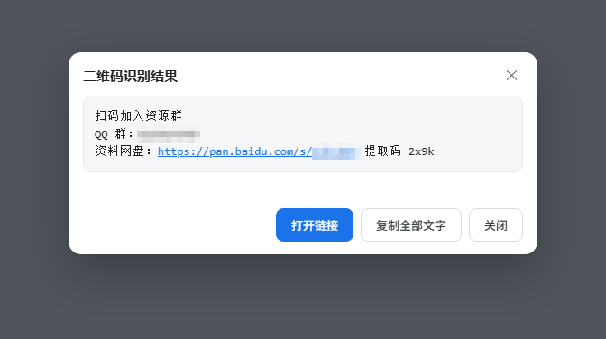
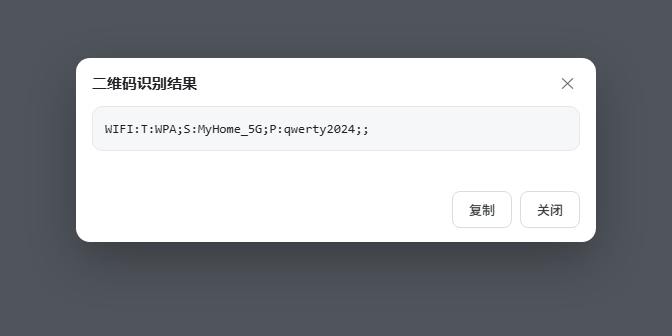

# local-QR

Chrome / Edge 扩展。在网页图片上右键识别二维码，全程本地计算，图像不上传。

| 整段就是一个链接 | 文字里夹着链接 | 纯文字 |
|---|---|---|
|  |  |  |
| 打开链接 · 复制 · 关闭 | 打开链接 · 复制全部文字 · 关闭 | 复制 · 关闭 |

## 安装

下载 [Releases](https://github.com/KanaBackyard/local-QR/releases/latest) 里的 `qr-local-1.3.0.zip`，打开 `chrome://extensions`（Edge 是 `edge://extensions`），开启「开发者模式」，把 zip 直接拖进去。

也可以解压后用「加载已解压的扩展程序」选目录。自己打包：

```bash
zip -r qr-local-1.3.0.zip manifest.json background.js decode.js popup.html lib icons
```

zip 内路径分隔符必须是 `/`。用 PowerShell 的 `Compress-Archive` 会写成 `\`，Chrome 解压后找不到 `icons/icon16.png`。

## 用法

在网页图片上右键，选「识别图片中的二维码」。

- 整段是一个链接：正文按纯文本显示，点「打开链接」跳当前标签页
- 文字里夹着链接：链接渲染成可点的超链接，点「复制全部文字」拿整段原文
- 纯文字：只有「复制」
- 面板可用 ✕、点遮罩空白、`Esc` 关闭

链接只认 `http://` 和 `https://`。遇到空白、引号、尖括号、中文或全角标点就截断，所以
`详情见（https://example.com/a?b=1）谢谢` 里只有括号内那段是链接。

## 权限

| 权限 | 用途 |
|---|---|
| `contextMenus` | 右键菜单项 |
| `activeTab` | 点菜单时临时获得当前标签页访问权 |
| `scripting` | 注入解码脚本取像素 |
| `clipboardWrite` | 复制按钮 |

没有 `host_permissions`，没有 `<all_urls>`，不存在常驻内容脚本。

## 解码流程

取像素有两条路：

1. canvas 直读 —— 同源图或带 CORS 头的图，用原图分辨率
2. 整页截图裁剪 —— 跨域图会让 canvas 污染，改用 `captureVisibleTab` 截图后按 `getBoundingClientRect` 裁

解码交给 [jsQR](https://github.com/cozmo/jsQR)。jsQR 直接吃原始像素对彩色渐变、圆点风、模块过细或留白过多的图容易失败，所以前面套了一层按代价递增的预处理，命中即止：

| 顺序 | 处理 |
|---|---|
| 1 | 原始像素 |
| 2 | `min`/`lum` 通道 + 自适应阈值阶梯（积分图，窗口半径 ×0.75 到 ×3） |
| 3 | 小图放大 2 倍 |
| 4 | 规范化：裁留白 → 补静区 → 缩放到 240/160/320 |
| 5 | 原尺寸按墨迹包围盒裁剪 |
| 6 | 轻微模糊后再自适应（圆点、菱形模块先糊成块） |
| 7 | `sat`/`max` 通道、Otsu 全局阈值 |

跳转不靠 `<a href>` 直接导航。面板把 URL 发给后台，后台再校验一次 `http(s)` 才调 `tabs.update`，`javascript:` / `data:` / `file:` 一律拒绝。在 iframe 里识别也能跳顶层。

## 已知限制

- `chrome://`、扩展商店等页面禁止注入脚本
- 跨域图片在子 iframe 里时无法截图裁剪，坐标系对不上
- 二维码缺角、遮挡过多、或模块小于约 1.5 像素时识别不了
- 一张图有多个二维码只返回第一个

## 开发

无构建步骤，改完源码在 `chrome://extensions` 点「重新加载」。

```
manifest.json    MV3 清单
background.js    Service Worker：菜单、解码编排、跳转校验
decode.js        页面内解码器 + 结果面板（按需注入）
popup.html       工具栏弹窗
lib/jsQR.js      jsQR 1.4.0
icons/           16/32/48/128
docs/            README 截图
```

## 许可

MIT。`lib/jsQR.js` 为 [jsQR](https://github.com/cozmo/jsQR) 1.4.0，MIT，版权归 cozmo 及贡献者。
