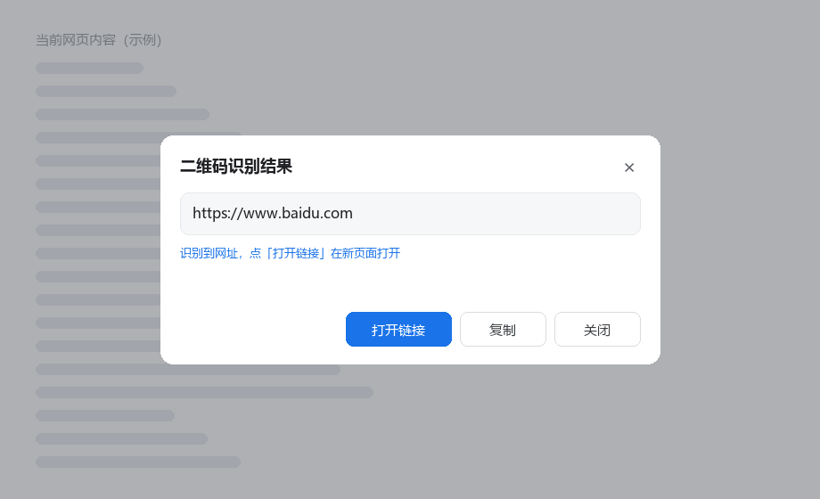

# local-QR · 本地二维码识别

一款 Chrome / Edge 扩展：在网页图片上右键即可识别二维码。
**全程本地运算**——二维码图像不上传、不联网，扩展也不申请常驻的网页读取权限。

识别成功后**不会自动跳转**，而是弹出结果面板，由你决定下一步。

| 识别到网址 | 识别到其它内容 |
|---|---|
|  |  |

---

## 功能

- 右键任意图片 → 「识别图片中的二维码」
- 识别出 `http(s)` 网址：点「打开链接」才跳转当前标签页
- 识别出其它内容（纯文本、WiFi 配置、vCard 等）：点「复制」写入剪贴板
- 同时支持正片与**反色**二维码（深底浅码）
- 小图自动放大重试；网页上显示得再小，解码也用原图分辨率
- 跨域图片（canvas 被污染）自动退化为截图裁剪解码
- 面板可用 ✕ / 点击遮罩 / `Esc` 关闭，内容可鼠标选中

## 安装

### 从源码加载

1. 下载本仓库（`Code` → `Download ZIP`，或 `git clone`）
2. 打开 `chrome://extensions`（Edge 为 `edge://extensions`）
3. 右上角开启「开发者模式」
4. 点「加载已解压的扩展程序」，选择**含 `manifest.json` 的那一层目录**
5. 工具栏出现蓝色二维码图标即安装成功

### 打包成 zip

仓库根目录已附带构建好的 `qr-local-1.0.0.zip`，可直接下载后拖入 `chrome://extensions` 安装。

自行打包时：

```bash
zip -r qr-local-1.0.0.zip manifest.json background.js decode.js popup.html lib icons
```

> 注意：zip 内的路径分隔符必须是 `/`。用 Windows PowerShell 的 `Compress-Archive`
> 会写成 `\`，Chrome 解压时会把 `icons\icon16.png` 当成文件名而不是目录，
> 导致 `Could not load icon 'icons/icon16.png'`。

## 使用

1. 在网页图片上点右键
2. 选择「识别图片中的二维码」
3. 结果面板：

| 按钮 | 行为 |
|---|---|
| 打开链接 | 仅当内容是 `http(s)` 网址时出现；点击后跳转当前标签页 |
| 复制 | 写入剪贴板（`navigator.clipboard` → `execCommand` 两级降级） |
| 关闭 | 或点遮罩空白 / 按 `Esc` |

## 权限

只申请三个权限，没有 `host_permissions`，没有 `<all_urls>`，不读取浏览记录，不注入常驻脚本。

| 权限 | 用途 |
|---|---|
| `contextMenus` | 添加右键菜单项 |
| `activeTab` | 仅在你点菜单的那一刻授予当前标签页临时访问权 |
| `scripting` | 把解码脚本注入当前页面取像素 |
| `clipboardWrite` | 「复制」按钮写入剪贴板 |

## 工作原理

1. **页面内 canvas 直读**：同源图 / 带 CORS 头的图，直接用原图分辨率取 `ImageData`
2. **整页截图裁剪**：跨域图片会让 canvas 被污染（`getImageData` 抛 `SecurityError`），
   此时用 `captureVisibleTab` 截图，按元素 `getBoundingClientRect` 裁剪出该图区域再解码
3. 解码统一交给 [jsQR](https://github.com/cozmo/jsQR)（纯 JS，无 WASM、无网络）

识别结果通过 Shadow DOM 渲染面板，不受目标页面 CSS 影响。

### 安全处理

「打开链接」不是 `<a href>`，而是把 URL 发给后台由后台再校验一次：

- 只放行 `http(s)://` 且不含空白的 URL
- `javascript:` / `data:` / `file:` 一律拒绝
- 在 iframe 中识别也能跳转顶层标签页

## 已知边界

- `chrome://`、扩展商店等页面禁止注入脚本，只能靠图标角标提示
- 跨域图片位于**子 iframe** 中时无法截图裁剪（坐标系不同），会提示失败
- 二维码模块过小（约 < 1.5 像素/模块）时无法识别，先放大图片再试
- 一张图有多个二维码时只返回第一个

## 开发

无需构建步骤，改完源码在 `chrome://extensions` 点「重新加载」即可。

```
.
├── manifest.json    扩展清单（MV3）
├── background.js    Service Worker：右键菜单、解码编排、跳转校验
├── decode.js        页面内解码器 + 结果面板（按需注入）
├── popup.html       工具栏图标弹窗
├── lib/jsQR.js      jsQR 1.4.0
├── icons/           16/32/48/128
└── docs/            README 截图
```

## 许可证

本扩展代码以 [MIT](LICENSE) 发布。
`lib/jsQR.js` 为 [jsQR](https://github.com/cozmo/jsQR) 1.4.0，同样以 MIT 授权，版权归 cozmo 及贡献者。
